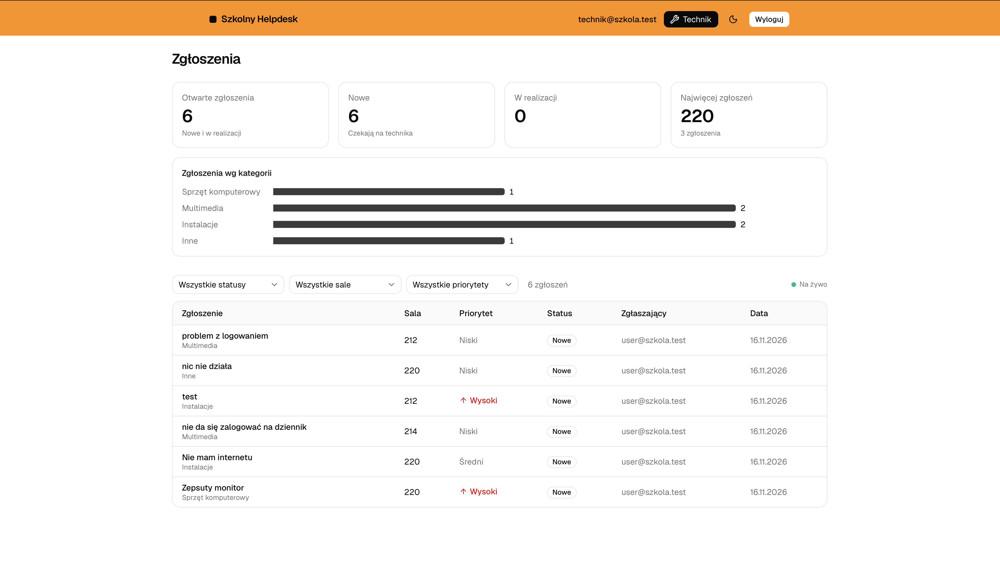
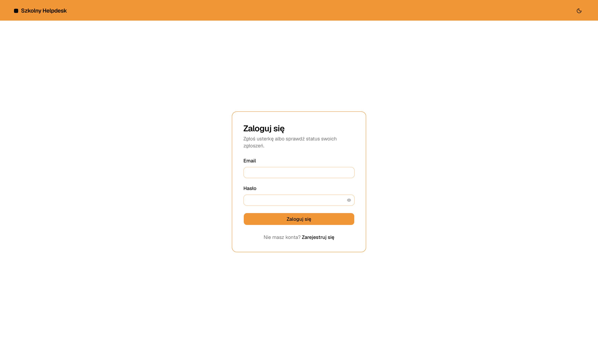
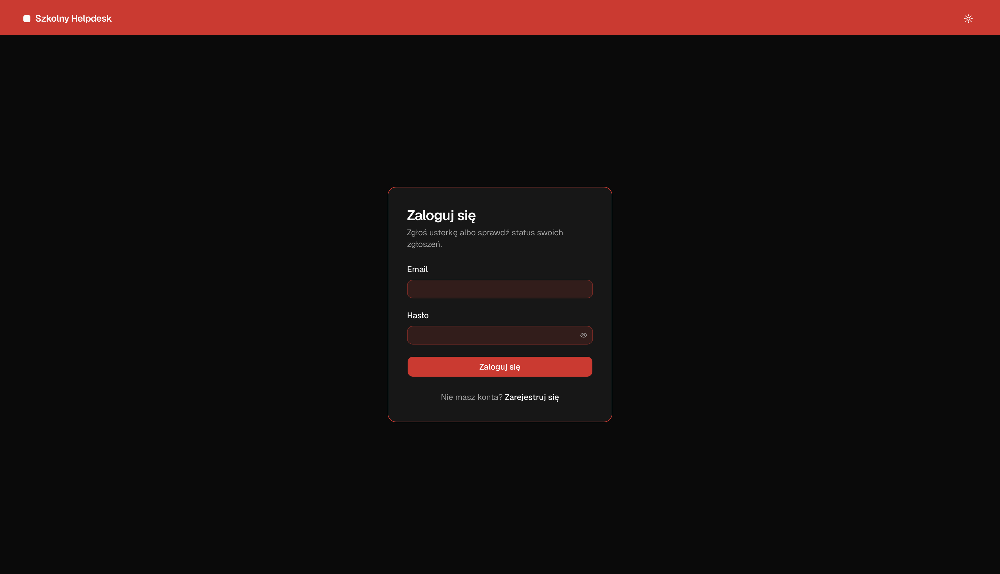
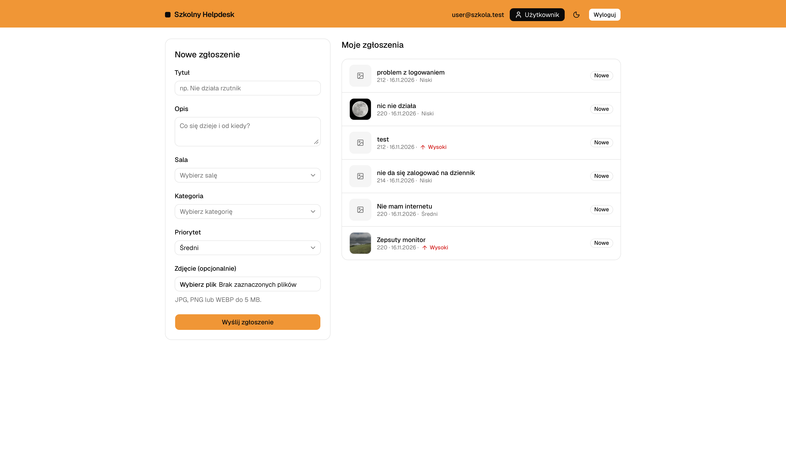
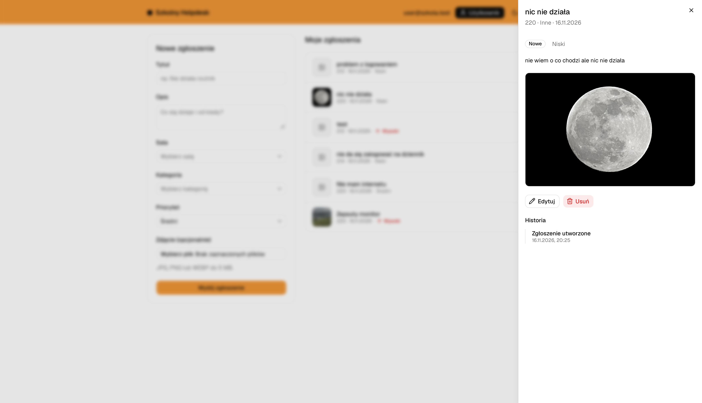
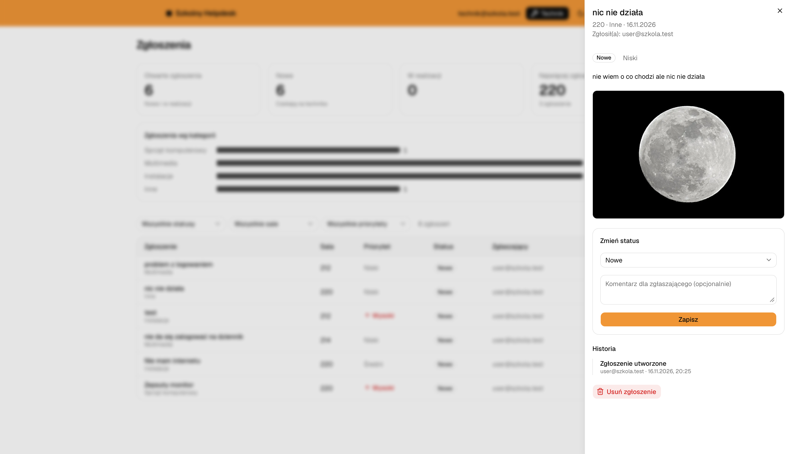
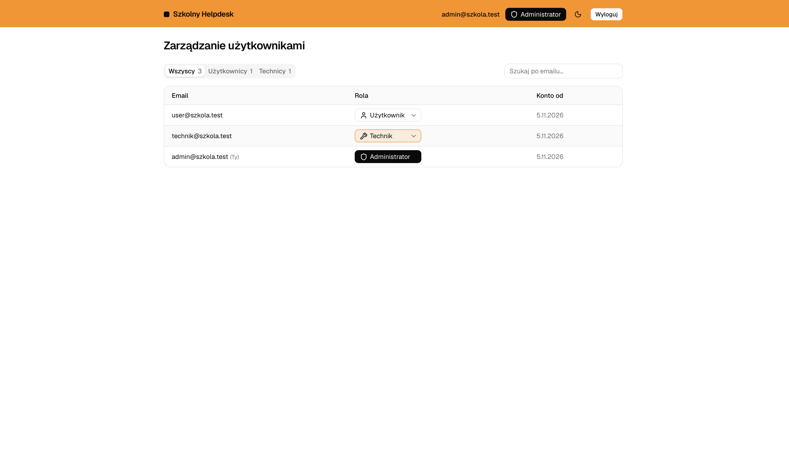
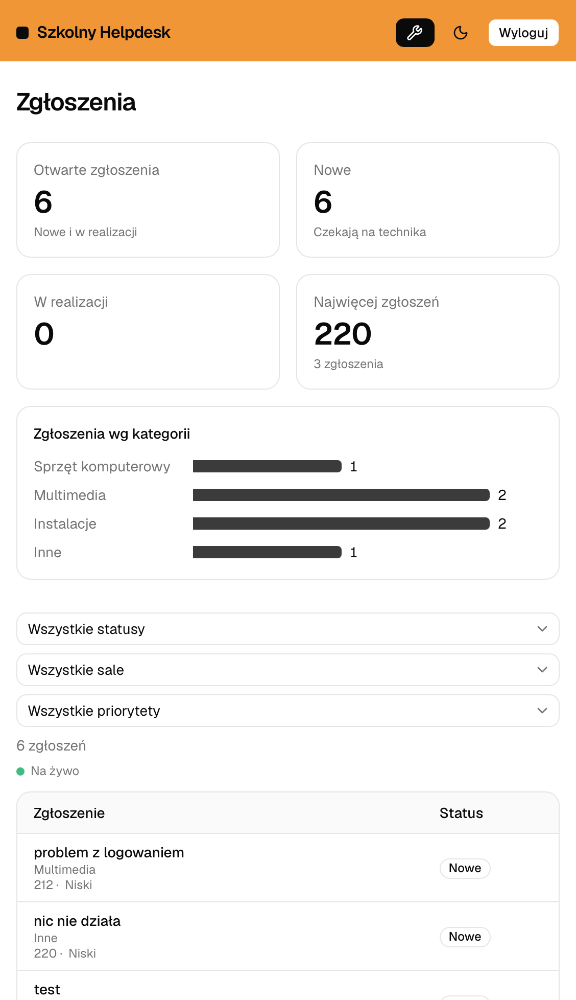

# Szkolny Helpdesk

Aplikacja do zgłaszania usterek w szkole. Nauczyciel zgłasza problem razem ze zdjęciem, a technik widzi wszystkie zgłoszenia, zmienia ich status i zostawia komentarz. Cała historia zmian jest zapisywana.



## Funkcje

- Rejestracja i logowanie emailem i hasłem.
- Trzy role: użytkownik, technik i administrator.
- Użytkownik dodaje zgłoszenie z tytułem, opisem, salą, kategorią, priorytetem i jednym zdjęciem do 5 MB. Widzi tylko swoje zgłoszenia i może je edytować albo wycofać, dopóki nikt się nimi nie zajął.
- Technik widzi wszystkie zgłoszenia w tabeli, filtruje je po statusie, sali i priorytecie oraz zmienia status z komentarzem.
- Lista technika odświeża się sama, gdy pojawi się nowe zgłoszenie.
- Historia zmian statusu: kto, kiedy, z jakiego statusu na jaki i z jakim komentarzem.
- Dashboard technika: liczba otwartych zgłoszeń, zgłoszenia według kategorii i sala z największą liczbą zgłoszeń.
- Administrator zmienia role kont między użytkownikiem a technikiem.
- Tryb jasny i ciemny, widok dopasowany do telefonu.

## Technologie

- Next.js 16 z App Router i React 19
- shadcn/ui i Tailwind CSS 4
- react-hook-form i zod
- PocketBase jako baza i system kont
- Coolify do wdrożenia

## Zrzuty ekranu

| Logowanie | Logowanie w trybie ciemnym |
|---|---|
|  |  |

| Panel użytkownika | Szczegóły zgłoszenia |
|---|---|
|  |  |

| Panel technika | Zmiana statusu i historia |
|---|---|
|  |  |

| Panel administratora | Telefon |
|---|---|
|  |  |

## Role

| Rola | Uprawnienia |
|---|---|
| `user` | dodaje zgłoszenia, widzi własne, edytuje i usuwa je do czasu przyjęcia przez technika |
| `technician` | widzi wszystkie zgłoszenia, zmienia status z komentarzem, usuwa zgłoszenia, korzysta z dashboardu |
| `admin` | zmienia role kont w panelu `/admin`, nie widzi zgłoszeń |

Rejestracja zawsze tworzy konto użytkownika. Konta technika i administratora zakłada superuser PocketBase, ustawiając pole `role`. Usuwać konta może tylko superuser.

## Uruchomienie lokalnie

Potrzebujesz Node.js 20.9 lub nowszego i [PocketBase](https://pocketbase.io/docs/), który jest jednym plikiem wykonywalnym.

**1. PocketBase**

Uruchom `./pocketbase serve`, otwórz `http://127.0.0.1:8090/_/` i załóż konto superusera.

**2. Kolekcje i reguły**

W panelu wejdź w *Settings → Import collections*, wklej zawartość [pocketbase/pb_schema.json](pocketbase/pb_schema.json) i zatwierdź. Powstaną kolekcje `users`, `rooms`, `tickets` i `ticket_events` razem z regułami API.

**3. Dane startowe**

W kolekcji `rooms` dodaj kilka sal. Konto użytkownika możesz założyć przez rejestrację w aplikacji. Konta technika i administratora utwórz w kolekcji `users`, ustaw pole `role` i zaznacz `emailVisibility`, żeby technik widział, kto zgłasza.

**4. Aplikacja**

```bash
npm install
cp .env.example .env.local
npm run dev
```

Aplikacja działa pod `http://localhost:3000`. Domyślny adres PocketBase w `.env.local` to `http://127.0.0.1:8090`.

Wersję produkcyjną uruchomisz przez `npm run build` i `npm start`.

## Zmienne środowiskowe

| Zmienna | Opis |
|---|---|
| `POCKETBASE_URL` | adres PocketBase, czytany tylko na serwerze Next.js |

Zmienna nie ma prefiksu `NEXT_PUBLIC_`, więc nie trafia do przeglądarki i nie jest wbudowana w kod podczas buildu. Można ją zmienić bez ponownego budowania.

## Wdrożenie w Coolify

Potrzebne są dwie usługi w jednym projekcie, obie za HTTPS.

**PocketBase.** Dodaj usługę z szablonu PocketBase. Szablon tworzy wolumen na dane, a w sekcji *Persistent Storage* powinien być wpis ze ścieżką `/app/pb_data`. Tam leży baza i wszystkie zdjęcia, więc restart ani redeploy nie kasuje danych. Po pierwszym starcie załóż superusera i zaimportuj [pocketbase/pb_schema.json](pocketbase/pb_schema.json).

**Aplikacja.** Dodaj aplikację z repozytorium i gałęzi `main`. W zmiennych środowiskowych ustaw `POCKETBASE_URL` na adres PocketBase bez ukośnika na końcu. Adres musi być osiągalny z kontenera aplikacji, a ciasteczko logowania ma flagę `secure`, więc strona musi działać przez HTTPS.

Trwałość danych możesz sprawdzić tak: dodaj rekord w PocketBase, zrestartuj usługę i zobacz, czy rekord nadal jest.

## Reguły API

Reguły są ustawione w PocketBase, więc chronią dane także przy zapytaniach wysyłanych ręcznie. Pełna definicja jest w [pocketbase/pb_schema.json](pocketbase/pb_schema.json).

| Kolekcja | Odczyt | Tworzenie | Zmiana | Usuwanie |
|---|---|---|---|---|
| `users` | admin widzi listę, konto widzi siebie, technik i admin widzą pojedyncze konta | tylko z rolą `user` | admin zmienia tylko rolę między `user` a `technician`, nie rusza innych adminów | tylko superuser |
| `rooms` | każdy zalogowany | tylko superuser | tylko superuser | tylko superuser |
| `tickets` | autor albo technik | tylko `user` jako autor, ze statusem `new` i bez komentarza | technik zmienia status i komentarz, autor treść do czasu przyjęcia | technik albo autor do czasu przyjęcia |
| `ticket_events` | technik albo autor zgłoszenia | tylko technik we własnym imieniu, ze statusem zgodnym ze zgłoszeniem | zablokowana | zablokowane, wpisy znikają razem ze zgłoszeniem |

Pozostałe zabezpieczenia:

- Token sesji leży w ciasteczku `httpOnly`. Przeglądarka nie łączy się z PocketBase bezpośrednio, wszystkie zapytania przechodzą przez serwer Next.js.
- Zdjęcia są plikami chronionymi. Aplikacja pobiera je z krótkotrwałym tokenem, a reguła odczytu zgłoszenia obowiązuje też dla zdjęcia.
- Strumień realtime odpowiada tylko technikowi, pozostali dostają 403.
- Repozytorium nie zawiera haseł ani tokenów, a wzór konfiguracji jest w [.env.example](.env.example).

## Struktura projektu

```
src/
  app/
    login, register/      logowanie i rejestracja
    user/                 panel użytkownika
    technician/           panel technika
    admin/                panel administratora
    api/tickets/          zdjęcia zgłoszeń i strumień realtime
  components/             wspólne komponenty i shadcn/ui
  lib/                    PocketBase, akcje serwerowe, schematy zod
  proxy.js                przekierowanie niezalogowanych na /login
pocketbase/pb_schema.json kolekcje i reguły API
```
